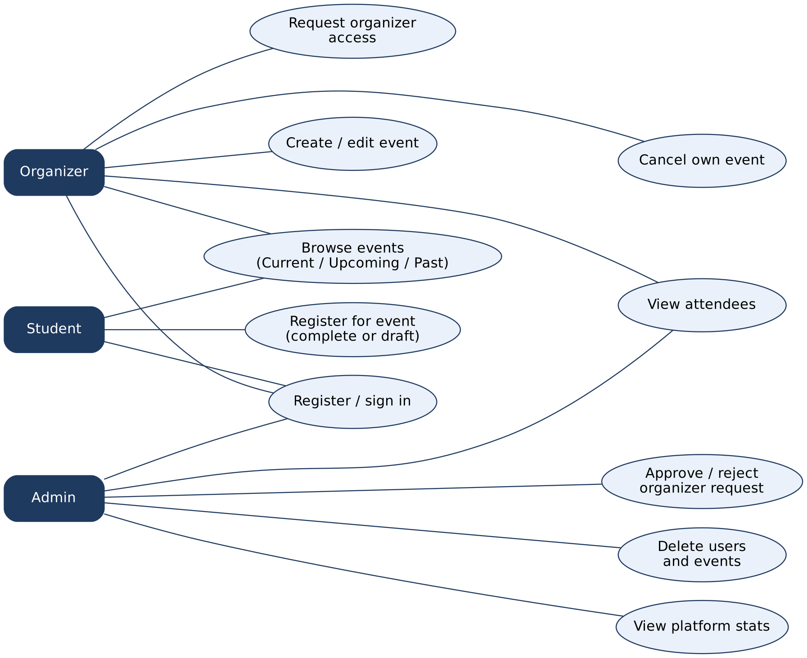
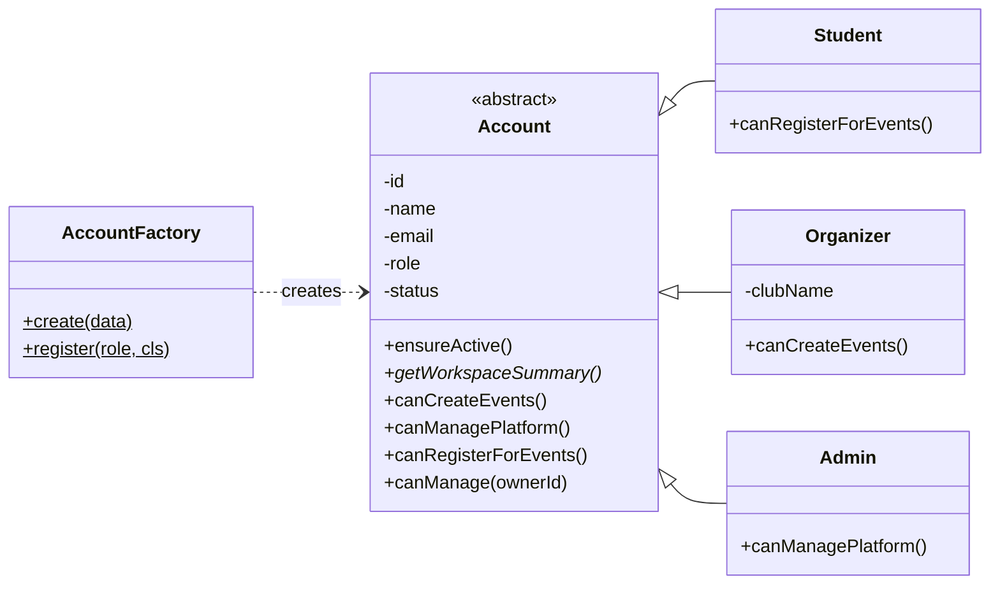
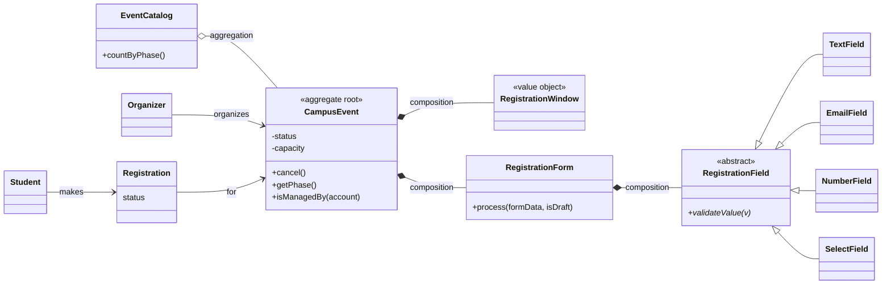
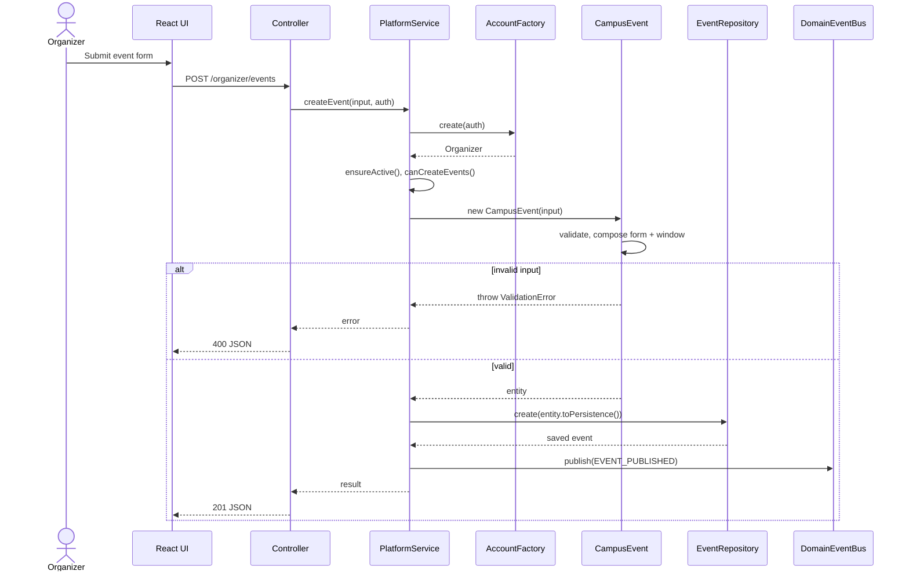
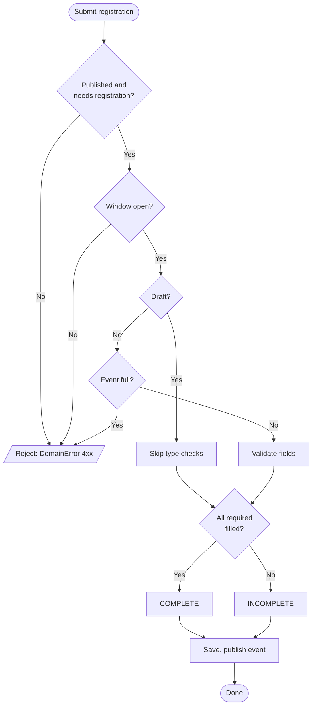
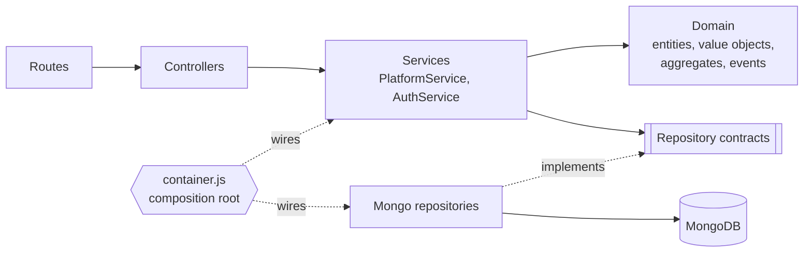

# IIITA Connect — Object-Oriented Design Notes

This document maps the implemented code to the OOM syllabus. Every claim below is exercised by an automated test
(`cd backend && npm test`, 23 tests, no database required). PNG renders of all diagrams are in `docs/diagrams/`.

## Concept → code map

| OOM concept | Where it is implemented | Verified by test |
|---|---|---|
| Classes, objects, attributes, constructors | `Account`, `CampusEvent`, `RegistrationField`, `RegistrationForm` | Classes/constructors |
| Encapsulation | `#private` fields + getters in every entity; `RegistrationWindow` is frozen | Encapsulation |
| Abstraction | Abstract `Account` and `RegistrationField` (`new.target` guard); repository contracts | Classes/constructors, Field hierarchy |
| Inheritance | `Student`/`Organizer`/`Admin` extend `Account`; `TextField`/`EmailField`/`NumberField`/`SelectField` extend `RegistrationField`; `ValidationError`/`NotFoundError`/... extend `DomainError`; Mongo repos extend contracts | Inheritance |
| Polymorphism | `getWorkspaceSummary()`, `canCreateEvents()`, `canManagePlatform()`, `canRegisterForEvents()`, `validateValue()` | Polymorphism, Field hierarchy |
| Association | `Organizer 1—0..* CampusEvent` (`organizerId`); `Student 1—0..* Registration`; `Registration *—1 CampusEvent` | Access rules |
| **Aggregation** | `EventCatalog` groups `CampusEvent`s without owning them (`domain/aggregates/EventCatalog.js`); used by `platformStats()` | Event phase and EventCatalog |
| **Composition** | `CampusEvent` creates and owns a `RegistrationForm` (which owns its `RegistrationField`s) and a `RegistrationWindow` | Composition |
| Exception handling | `DomainError` hierarchy → one error middleware; repositories translate Mongo errors | Exception hierarchy, service tests |
| Modularity | routes → controllers → services → domain; repositories behind contracts; `container.js` wires everything | Service tests with in-memory fakes |

## Design principles (SOLID)

| Principle | How the code follows it |
|---|---|
| **S**ingle Responsibility | Controllers translate HTTP; services coordinate use-cases; entities hold business rules (`CampusEvent` validates and owns lifecycle; `RegistrationForm` validates answers); repositories persist. |
| **O**pen/Closed | New role: `AccountFactory.register(role, Class)`. New field type: `RegistrationFieldFactory.register(type, Class)`. New reaction to an event: `bus.subscribe(...)`. No existing code changes. |
| **L**iskov Substitution | Services use `Account` capabilities, so any subclass works; in tests, in-memory repositories replace Mongo ones with identical behaviour. |
| **I**nterface Segregation | Four small repository contracts (`User`, `OrganizerRequest`, `Event`, `Registration`) instead of one large data-access interface. JavaScript has no `interface` keyword, so contracts are abstract classes. |
| **D**ependency Inversion | `PlatformService` and `AuthService` receive repositories, hasher, token signer and event bus through their constructors and import no Mongoose model. |

## Design patterns

| Pattern | Location |
|---|---|
| Factory | `AccountFactory`, `RegistrationFieldFactory` |
| Repository | `repositories/contracts.js` + `repositories/mongo/*` |
| Observer | `DomainEventBus` + `services/eventHandlers.js` (cancelling an event clears registrations) |
| Dependency Injection / Composition root | `container.js` |
| Aggregate root + Value object (DDD) | `CampusEvent`, `RegistrationWindow` |
| Template method | `Account` capability hooks; `RegistrationField.validateValue` |
| Chain of Responsibility | Express middleware: `authenticate` → `allowRoles` → handler → `errorHandler` |
| Layered architecture | Routes → Controllers → Services → Domain / Repositories |

## UML diagrams

### Use-case diagram

### Class diagram 1 — account hierarchy and factory

### Class diagram 2 — event model (composition, aggregation, association)

### Sequence diagram — publish an event

### Activity diagram — register for an event

### Layered architecture

## Behaviour fixed while adding these features

- Registration window (opens / deadline) is now enforced on the server; previously only the UI respected it.
- A student who already holds a COMPLETE seat can re-submit when the event is full.
- Permission checks use `account.canManage(...)` / `canManagePlatform()` instead of `role === '...'` strings.
- Business errors are `DomainError` subclasses everywhere (the services previously threw ad-hoc errors).
- Removed the unused duplicate `authService.requestOrganizer`.
- `GET /api/auth/me` and login now include `workspaceSummary`, produced polymorphically by the role object.
- `GET /api/auth/admin/stats` now includes `eventPhases` (`CURRENT` / `UPCOMING` / `PAST` counts) from `EventCatalog`.

## Known limits

- JavaScript has no static interfaces or `final`; abstraction is enforced at runtime (`new.target`, "not implemented" errors).
- Aggregation and composition are modelling relationships between in-memory domain objects; MongoDB still stores them as embedded data or ObjectId references.
- The React frontend was not changed.
